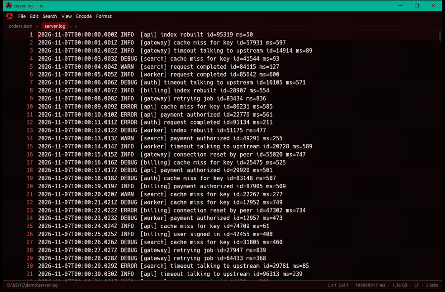
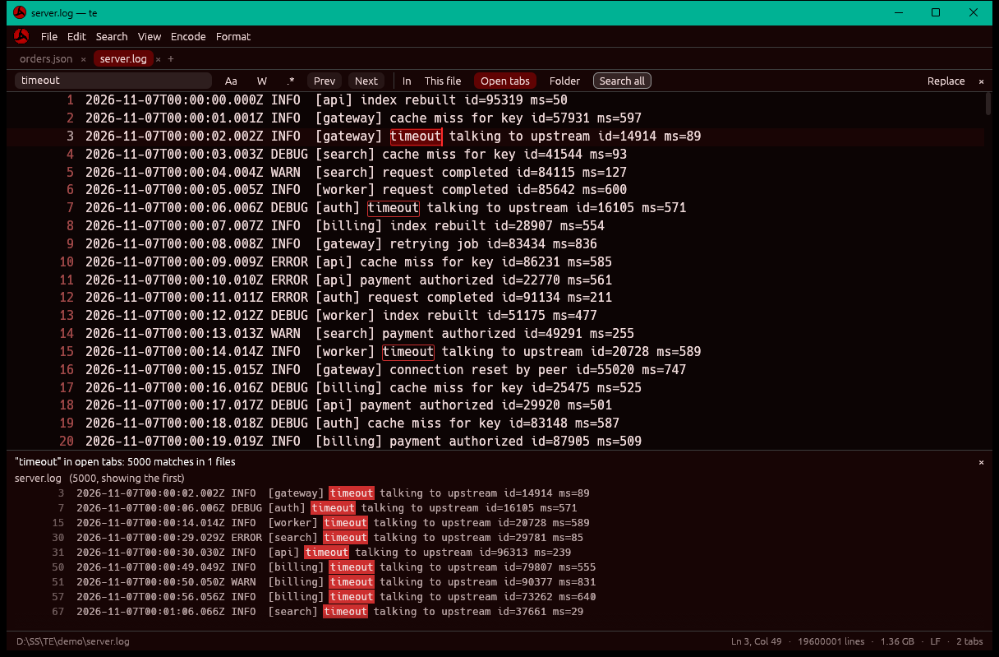
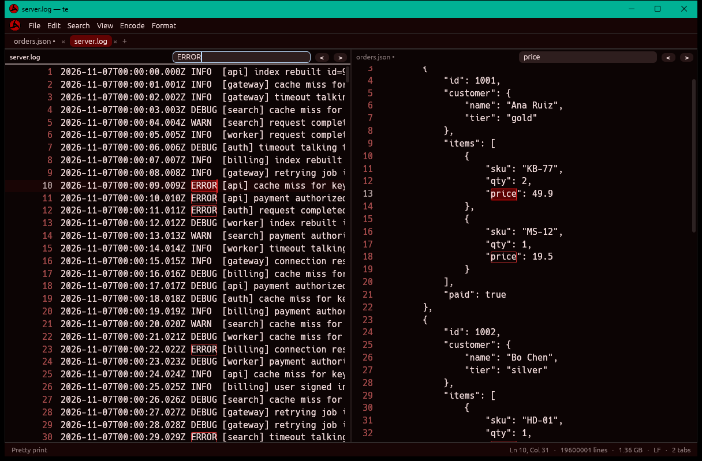
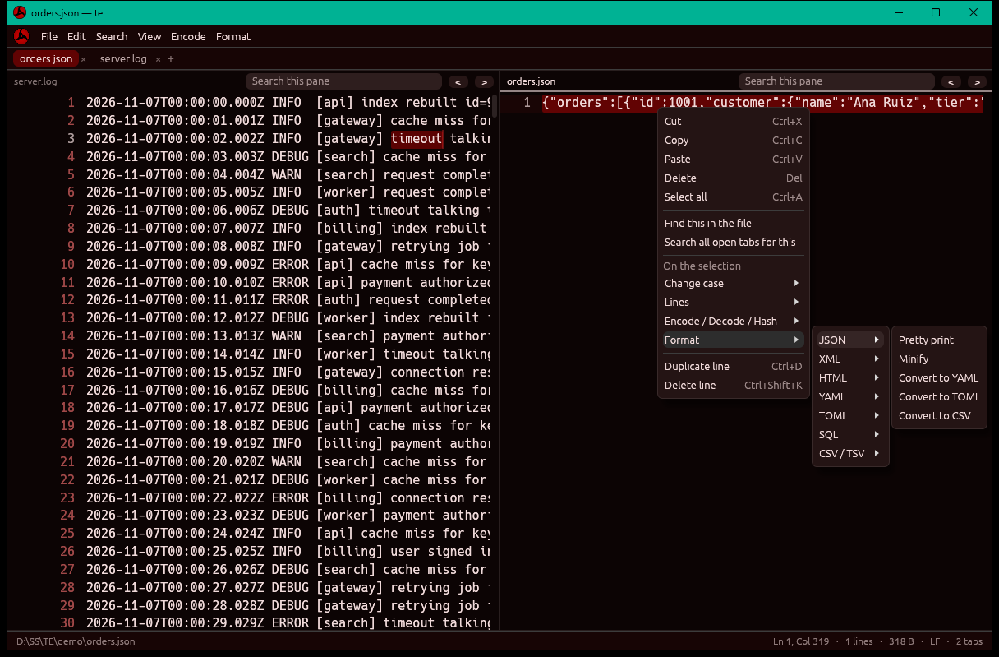
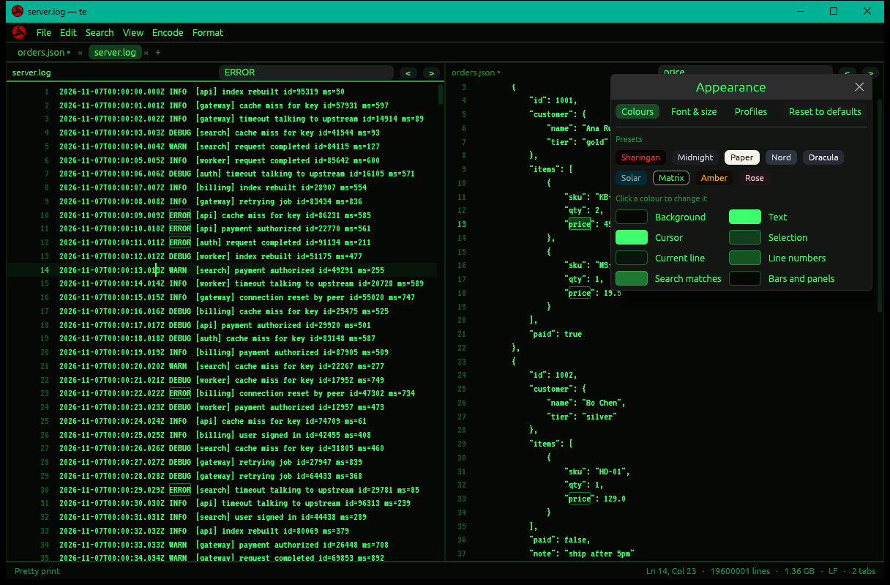

<p align="center">
  
</p>

<p align="center">
  <a href="https://github.com/boode-hub/te/releases/latest"></a>
  <a href="#download-and-run"></a>
  <a href="#under-the-hood"></a>
  <a href="#under-the-hood"></a>
  <a href="https://buymeacoffee.com/boode"></a>
</p>

<p align="center">
  A text editor that opens a two-gigabyte log as fast as a two-line note, and never freezes doing it.<br>
  Tabs, split view, regex search across files, encoders, formatters and file splitting, dressed in Sharingan crimson and black.<br>
  <b>Portable.</b> One exe, no installer, no admin rights, nothing written to the registry.
</p>

<p align="center">
  <a href="#download-and-run"><b>Download</b></a> &nbsp;&bull;&nbsp;
  <a href="#why-te"><b>Why te</b></a> &nbsp;&bull;&nbsp;
  <a href="#features"><b>Features</b></a> &nbsp;&bull;&nbsp;
  <a href="#shortcuts"><b>Shortcuts</b></a> &nbsp;&bull;&nbsp;
  <a href="#under-the-hood"><b>Under the hood</b></a> &nbsp;&bull;&nbsp;
  <a href="#support"><b>Support</b></a>
</p>

<p align="center"></p>

<p align="center">
  
</p>

<a id="download-and-run"></a>

##  Download and run

*Three steps, under a minute. Never used GitHub before? Just follow along.*

1. **Download** [`te-x.x.x-win-x64.zip`](https://github.com/boode-hub/te/releases/latest) from the latest release.
2. Right-click the ZIP, choose **Extract All**, and pick any folder (a USB stick works too).
3. Open that folder and double-click **`te.exe`**.

That's it. Open a file with **File > Open**, by dropping it on the window, or with
**Open with > te** in Explorer. Drop a folder to browse it in the side panel.

> [!TIP]
> **"Windows protected your PC"?** te isn't code-signed yet, so SmartScreen asks
> once. Click **More info**, then **Run anyway**. Or, before extracting, right-click
> the ZIP, choose **Properties**, tick **Unblock**, and extract again.

| What's in the folder | |
| --- | --- |
| `te.exe` | the whole editor, fonts and icon built in |
| `te.cfg` | your settings and recent files, created on first run |
| `profiles/` | appearance profiles you save |
| `fonts/` | drop your own `.ttf` / `.otf` here and they appear in the font list |

**To uninstall,** delete the folder. Nothing else was ever touched.

<p align="center">
  <sub>Opening logs comfortably? A coffee keeps new features coming.</sub><br>
  <a href="https://buymeacoffee.com/boode"></a>
</p>

<p align="center"></p>

<a id="why-te"></a>

##  Why te

| | |
| --- | --- |
| **Fast** | A 1.5 GB, 12-million-line log opens in about 0.4 s. Jumping to any line takes microseconds, and regex search runs at over 1 GB/s. |
| **Never freezes** | Opening, searching big files, searching whole folders and splitting all run in the background. The window keeps drawing; Esc cancels. |
| **Light** | Files are memory-mapped, not loaded. Five 1.5 GB files open at once cost about 30 MB of te's own memory. Idle CPU is zero: te only draws when something changes. |
| **Safe** | Saves go to a temporary file that replaces the original only once it is complete, so a failed save never damages your file. Files under 64 MB are never locked while open. Updates are signed, checksummed and self-tested before they replace anything. |
| **Portable** | One exe. Settings sit next to it, so te travels on a USB stick. |

<p align="center"></p>

<a id="features"></a>

##  Features

<table>
  <tr>
    <td width="50%"></td>
    <td width="50%"></td>
  </tr>
  <tr>
    <td align="center"><b>Search anything.</b> Match case, whole word, regex; this file, every tab, or a whole folder.</td>
    <td align="center"><b>Split view.</b> Up to four panes, each scrolling and searching on its own.</td>
  </tr>
  <tr>
    <td width="50%"></td>
    <td width="50%"></td>
  </tr>
  <tr>
    <td align="center"><b>Right-click tools.</b> Format, encode, decode and hash the selection.</td>
    <td align="center"><b>Your look.</b> Themes, every colour mappable, 24 built-in fonts, saved profiles.</td>
  </tr>
</table>

| Area | What you get |
|---|---|
| Huge files | Multi-gigabyte files open in a blink and scroll smoothly; 100 MB single-line files (minified JSON) open in 20 ms |
| Editing | Typing, selection, copy / cut / paste, undo and redo, duplicate and delete line, change case, sort, dedupe, trim and join lines, CRLF or LF |
| Tabs and split view | Tabs, plus 2, 3 or 4 panes side by side or in a grid; drag the dividers to resize; drop a file onto the pane it should open in; right-click a tab to send it to a pane |
| Search | Find bar with match case, whole word and regex; replace one or all with `$1` groups; search this file, all open tabs or a whole folder in the background; a quick search box in each split pane |
| Encode and decode | Base64, Base64 URL-safe, Base32, hex, URL, HTML entities, `\uXXXX`, string escape and unescape, binary, ROT13, JWT |
| Hashes | MD5, SHA-1, SHA-256, SHA-512, CRC32, copied to the clipboard |
| Formatters | JSON (pretty, minify, to YAML / TOML / CSV, big numbers and key order kept), XML and HTML (pretty, minify, tolerant of broken markup), YAML, TOML, SQL, CSV / TSV (align as a table, to JSON) |
| Split into parts | File > Split into parts: numbered files of at most N bytes, KB, MB or GB, cut after full lines, for upload limits |
| Files | Open recent, open folder (side panel), reload, save as, save a copy, save all, drag and drop |
| Updates | Help > Check for updates: installs only releases signed with te's key, after checking the download's checksum and test-running the new version; the old one is kept until the new one has started |
| Looks | Sharingan crimson and black by default; 8 presets; every colour mappable with the Windows colour picker; 24 built-in fonts from pixel and sci-fi to coding fonts, plus every installed font; saved profiles; Itachi's Mangekyou logo |

<p align="center"></p>

<a id="shortcuts"></a>

##  Shortcuts

| Keys | Does | | Keys | Does |
| --- | --- | --- | --- | --- |
| `Ctrl+O` | Open | | `Ctrl+F` | Find |
| `Ctrl+Shift+O` | Open folder | | `Ctrl+H` | Replace |
| `Ctrl+S` | Save | | `F3` / `Shift+F3` | Next / previous match |
| `Ctrl+Shift+S` | Save as | | `Ctrl+Shift+F` | Search open tabs or folder |
| `Ctrl+N` | New tab | | `Ctrl+G` | Go to line |
| `Ctrl+W` | Close tab | | `Ctrl+\` | Split view |
| `Ctrl+Tab` | Next tab | | `Ctrl+B` | Folder panel |
| `Ctrl+Z` / `Ctrl+Y` | Undo / redo | | `Ctrl+D` | Duplicate line |
| `Ctrl++` / `Ctrl+-` | Bigger / smaller text | | `Ctrl+Shift+K` | Delete line |
| `Ctrl+,` | Appearance | | `Esc` | Close a bar, or cancel a running search |

Right-click the text for Cut, Copy, Paste and every tool.

<p align="center"></p>

<a id="under-the-hood"></a>

##  Under the hood

*Written in Rust with egui, drawn on the integrated GPU with DirectX 12.*

* **Files are mapped, not read.** Big files are memory-mapped and edits live in a
  piece table on top, so opening costs one pass to count lines (on every core) and
  nothing is copied into RAM. Files under 64 MB are read and released instead, so
  te never locks them.
* **A sparse line index.** One newline count per 64 KiB chunk, plus a cached
  running total per edit, means finding any line touches at most 64 KiB, whatever
  the file size. A screen of text takes about a millisecond even after 20,000
  scattered edits.
* **Search in slices.** Regex search reads 8 MiB blocks, with enough overlap and
  look-behind that results match a whole-file search exactly. Big files and folders
  are searched on background threads; results stream in and are capped so a search
  for "e" can't eat the machine.
* **Bounded memory.** Undo is capped by steps and by size, search results per file
  and in total, whole-file tools at 256 MB. Background jobs hold cheap snapshots
  that share the file, never a copy.

<details>
<summary><b>Build it yourself</b></summary>

Needs Rust 1.88 or newer on Windows.

```sh
cargo build --release            # target/release/te.exe, icon and fonts built in
target/release/te some.log
```

</details>

<details>
<summary><b>Tests and benchmarks</b></summary>

```sh
cargo test --release             # piece table, search, tools, editor, split, settings
TE_BENCH=big.log    cargo test --release bench        -- --ignored --nocapture
TE_BENCH=big.log    cargo test --release memory       -- --ignored --nocapture
TE_BENCH=big.log    cargo test --release split_speed  -- --ignored --nocapture
TE_FOLDER=D:\code   cargo test --release folder_load  -- --ignored --nocapture
```

The tests check the piece table against a plain byte array through hundreds of
random edits, regex scans across block edges, every encoder and decoder round trip,
3000 rounds of random garbage through every tool, failed saves (missing folder,
read-only file), background search and cancel, and that undo memory stays bounded.

</details>

<details>
<summary><b>Layout of the code</b></summary>

```
src/doc.rs      the document: file mapping, piece table, line index, regex scan
src/editor.rs   one tab: cursor, selection, undo, find, save, drawing
src/search.rs   find options and the background search across tabs or a folder
src/tools.rs    encoders, decoders, hashes, formatters, line tools
src/split.rs    split into parts
src/update.rs   update checks: version, Ed25519 signature, checksum, safe swap
src/updater.rs  Help > Check for updates: GitHub, download, self-test
src/main.rs     the window: menus, tabs, panes, panels, appearance, settings
build.rs        renders the Mangekyou logo into the exe icon
```

</details>

<p align="center"></p>

<a id="support"></a>

##  Support

If te saves you time, a coffee is the best thank-you. Bug reports and ideas
are welcome in [Issues](https://github.com/boode-hub/te/issues).

<p align="center">
  <a href="https://buymeacoffee.com/boode"></a>
</p>

## Credits

The logo is Itachi's Mangekyou Sharingan from the vector eyes of
[Sharingan-Monitor](https://github.com/boode-hub/Sharingan-Monitor) (MIT).
Built-in fonts: SIL Open Font License (Special Elite: Apache 2.0), licences in
`assets/fonts/`. egui: MIT/Apache-2.0.
